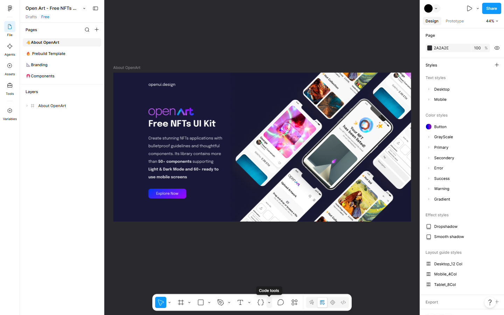
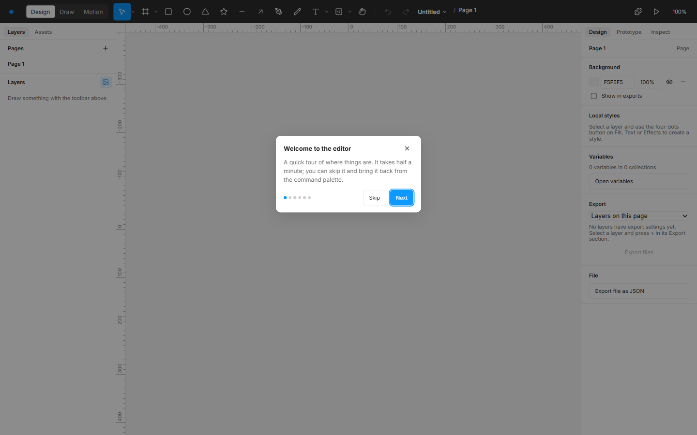
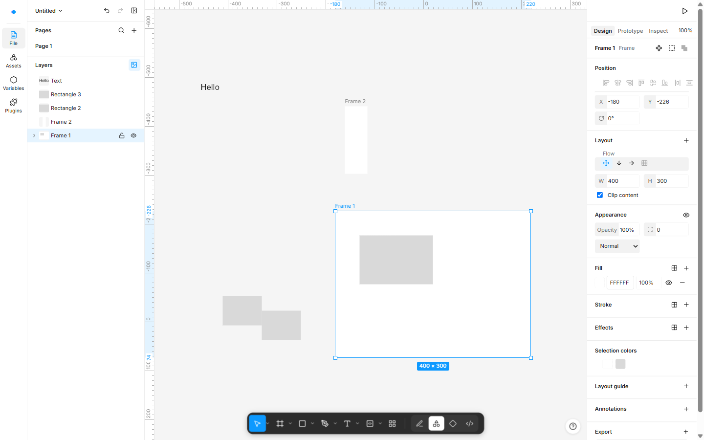
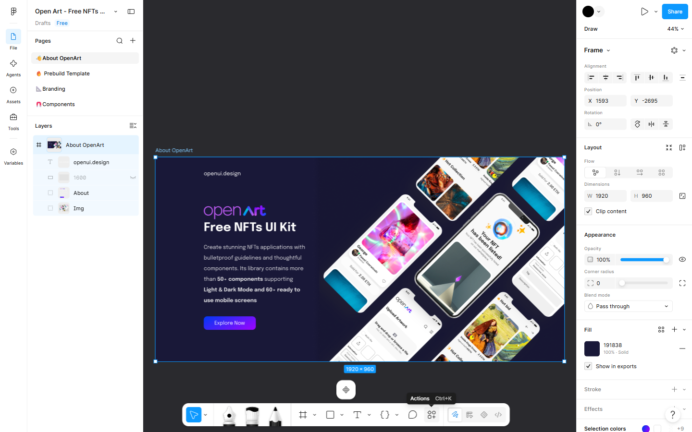
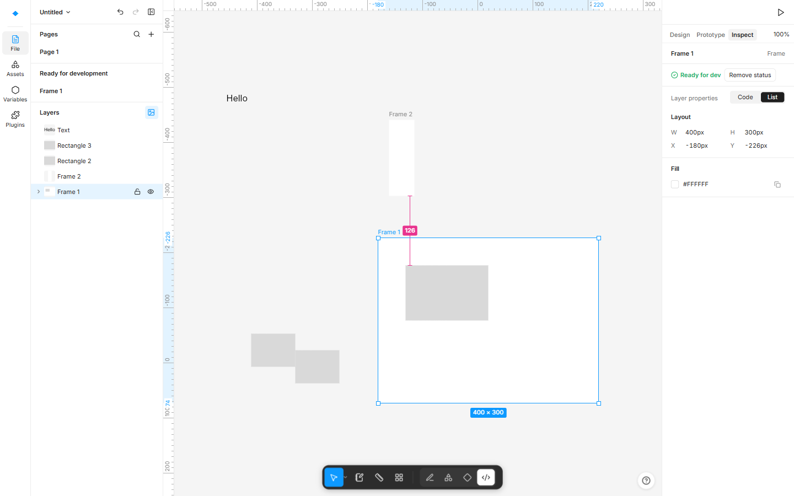
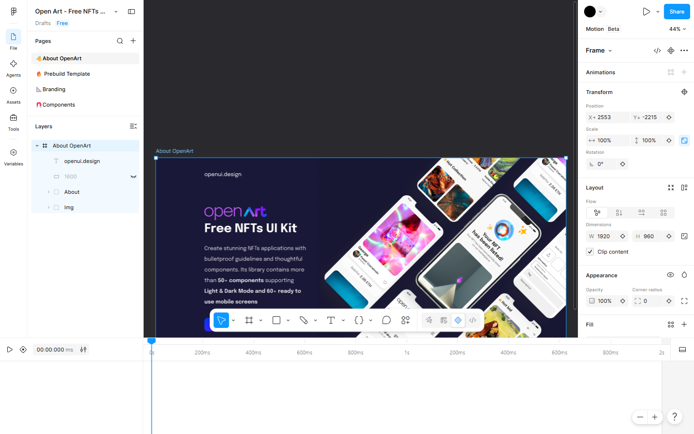
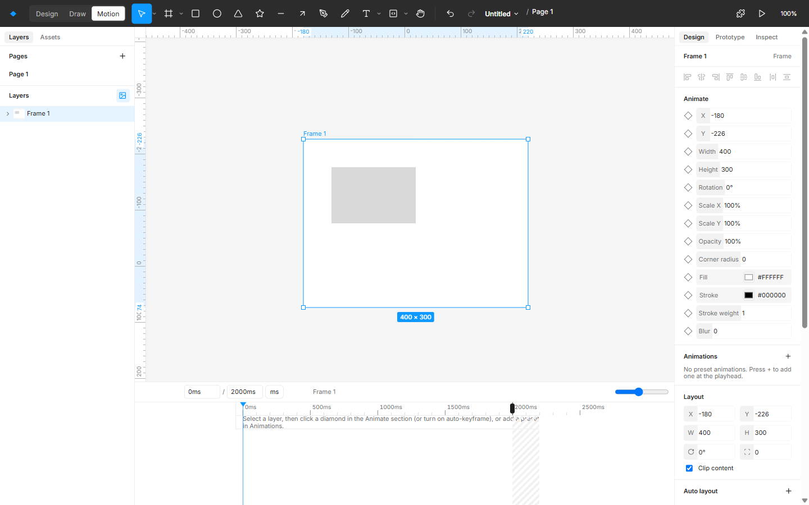
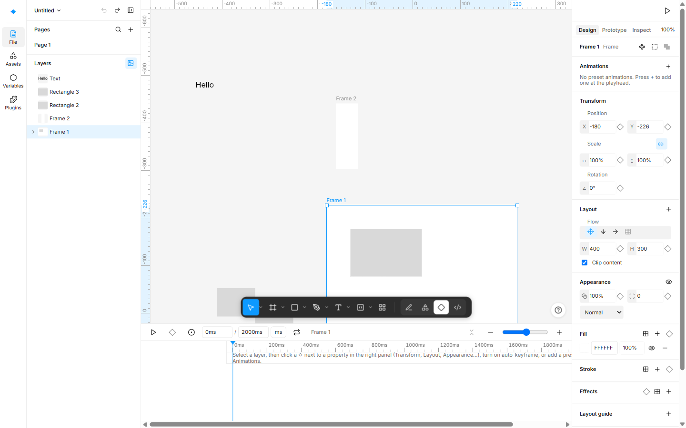

# Figma vs Design Clone: editor UI comparison

Captured on 2026-11-22 with the Playwright MCP server (Chrome, 1440×900).

- **Figma:** the live editor (UI3, Free plan) on an existing design file, opened read-only. Nothing was drawn or changed. Dev Mode needs a paid plan: it showed an upgrade screen with the Inspect panel only partly visible, so the Dev Mode rows also use Figma's help center ([Guide to Dev Mode](https://help.figma.com/hc/en-us/articles/15023124644247-Guide-to-Dev-Mode), [Add measurements and annotations](https://help.figma.com/hc/en-us/articles/20774752502935-Add-measurements-and-annotations-in-Dev-Mode)). Rows marked *(docs)* come from those pages.
- **Ours:** `pnpm --filter @figma/web dev` at `http://localhost:5280/local` (a local file), commit `e23f6a6` (latest `main`). Cloud-only UI (Comment tool, Share, version history) doesn't show at `/local`; it was checked in the source and is marked *(cloud files)*.

Status key: **Same** · **Different name or place** · **Missing in ours** · **Extra in ours**

| Figma | Ours |
| --- | --- |
|  |  |
|  |  |
|  |  |

## 1. Overall layout

| Feature | Figma (name, location) | Ours (name, location) | Status |
| --- | --- | --- | --- |
| Tool bar | Floating toolbar at the **bottom centre** of the canvas | Floating toolbar at the bottom centre of the canvas: tool slots, Actions, then the mode switch | Same (U5; ours is dark) |
| Navigation rail | Narrow left rail: **File**, **Agents**, **Assets**, **Tools**, **Variables** | Left rail: Main menu, then **File**, **Assets**, **Variables**, **Plugins** (our Tools) | Same (U5; no Agents) |
| Main menu | Figma logo button, top left of the left panel | **Main menu**: the ◆ logo button at the top of the rail | Same (U3, U5) |
| File name and location | Top of the left panel: file name + chevron (Edit file menu), with "Drafts · Free" under it | Top of the left panel: file name + chevron (file menu); cloud files show the project, sync status and "View only" | Same (U5) |
| Minimize UI | Button next to the file name; also View menu, Ctrl+Shift+\ | Button at the top of the left panel; View menu; Ctrl+Shift+\. The rail and toolbar stay; File or Assets in the rail brings the panels back | Same (U5) |
| Present / Share | Top of the right panel: avatars (Multiplayer tools), **Present** ▷ with **Prototype view** dropdown, **Share** | Top of the right panel: avatars, Present ▷, Share *(cloud files)* | Same (U5); no Prototype view dropdown |
| Zoom/view options | `44% ▾` on the right panel's tab row | `100%` at the right end of the right panel's tab row | Same (U5) |
| Undo / Redo buttons | None on screen (menu and shortcuts only) | Small buttons at the top of the left panel, next to the file name | Extra in ours (kept) |
| Help | `?` button, bottom right | `?` button at the bottom right of the canvas: Keyboard shortcuts, Show the editor tour | Same (U5) |
| Editor tour | — | "Welcome to the editor" tour on first open | Extra in ours |

## 2. Toolbar and tools (Design mode)

Figma groups the tools into seven slots with dropdowns. Since U2, ours does too.

| Figma slot → tools (shortcut) | Ours | Status |
| --- | --- | --- |
| **Move tools**: Move (V), **Hand tool** (H), Scale (K) | Move tools: Move (V), Hand tool (H), Scale (K) | Same (U2) |
| **Region tools**: Frame (F), Section (Shift+S), Slice (S) | Region tools: Frame (F), Section (Shift+S), Slice (S) | Same (U2) |
| **Shape tools**: Rectangle (R), Line (L), Arrow (Shift+L), Ellipse (O), Polygon, Star, **Image/video…** (Ctrl+Shift+K) | Shape tools: Rectangle (R), Line (L), Arrow (Shift+L), Ellipse (O), Polygon, Star, Image/video… (Ctrl+Shift+K) | Same (U2) |
| Image/video… | Image/video… in Shape tools and quick actions (Ctrl+Shift+K); images only | Same name and place (U2); no video yet |
| **Creation tools**: Pen (P), Pencil (Shift+P) | Creation tools: Pen (P), Pencil (Shift+P) | Same (U2) |
| **Type tools**: Text (T), **Text on path** | Text menu: Text (T), Text on path | Same (U1) |
| **Code tools**: Code (B), Spec (D) | Code tools: Code (B), Spec (D), **Code snippet**, **Annotation** (Shift+T) | Extra in ours (Code snippet and Annotation kept in this menu by choice) |
| **Comment** (C) | Comment (C) *(cloud files only)* | Same |
| **Actions** (grid icon, Ctrl+K): AI prompts plus the command list | **Actions** button (grid icon) after the tool slots; Ctrl+K (Ctrl+/ also works) | Same (U3; no AI prompts) |
| Annotation (Shift+T), Measurement (Shift+M) *(docs; not shown on the Free plan's Design toolbar)* | Annotation (Shift+T) in the Code tools menu; no Measurement tool (Alt-hover shows distances) | Different name or place / Missing in ours (Measurement) |
| Frame presets (right panel while the Frame tool is on) | Frame presets in the right panel (Phone, …) | Same |
| Measurement is Shift+M in Figma *(docs)* | Shift+M is Measurement in Dev Mode and Shape builder in Design mode | Same (U7) |

## 3. Modes

| Feature | Figma | Ours | Status |
| --- | --- | --- | --- |
| Mode switcher | Segmented icons at the **right end of the bottom toolbar**, in this order: **Draw**, **Design**, **Motion (Beta)**, **Dev Mode** | Icon toggles at the right end of the floating toolbar: Draw, Design, Motion, Dev Mode (Dev Mode = the Inspect tab) | Same (U5) |
| Mode name on the right panel | The tab row shows the mode: "Draw", "Motion Beta" | Draw shows "Draw" in the tab row; Motion keeps the Design / Prototype / Inspect tabs | Different name or place (Motion keeps its tabs) |
| Draw toolbar | Move, **Pen / Brush / Pencil** (drawn as real pens), Frame, Shape, Text, Code, Comment, Actions | Move tools, Pen, Brush, Pencil, Region, Shape, Type and Code tools (Comment on cloud files) | Same (U2; Actions comes in U3) |
| Dev Mode | Mode in the toolbar (Shift+D), paid plans; its own right panel (Inspect, Plugins) | **Dev Mode** toggle in the toolbar opens the Inspect tab | Different name or place (no Shift+D; same right panel) |

## 4. Left panel

| Feature | Figma | Ours | Status |
| --- | --- | --- | --- |
| Pages | "Pages" header, **search** and **+ (Add new page)** | "Pages" header with Find (magnifier) and + (Add new page) | Same (U5) |
| Layers | "Layers" header with a layout/collapse toggle; thumbnails for frames | "Layers" header with "Show layer icons" toggle; "Layer thumbnails" in quick actions | Same |
| Find | Find (magnifier) next to Pages; Edit > Find (Ctrl+F) | Magnifier next to Pages opens Find and replace (Ctrl+F); also Edit menu and Actions | Same (U5) |
| Assets | Left rail **Assets**: All libraries, Created in this file, UI kits (iOS and iPadOS, Material 3, Simple Design System), Add more libraries | Rail **Assets**: Local components, Libraries | Same place (U5); no UI kits |
| Variables | Left rail **Variables** (collections) | Rail **Variables** opens the variables window; also Open variables in the right panel | Same (U5) |
| Tools | Left rail **Tools**: plugins, widgets, shaders, AI image tools | Rail **Plugins**: built-in plugins, Write a plugin, Add from a URL / file | Different name (Plugins vs Tools) |
| Agents | Left rail **Agents** (AI chat on the file) | — | Missing in ours |

## 5. Right panel: Design tab

Nothing selected:

| Figma | Ours | Status |
| --- | --- | --- |
| **Page** (background colour, opacity, eye) | **Page** (colour, opacity, Hide, Remove, Show in exports) | Same (U1) |
| **Styles** with + : Text styles, Color styles, Effect styles, **Layout guide styles** | **Styles** (hint text until a style exists), groups Text / Color / Effect styles | Same (U1; no Layout guide styles yet) |
| Export | Export (Layers on this page / all pages, Export files) | Same |
| — | **File → Export file as JSON** | Extra in ours |

Layer selected (frame / group):

| Figma section → contents | Ours | Status |
| --- | --- | --- |
| Header: layer type with dropdown ("Frame ▾", "Group ▾"), quick buttons (component, mask, …) | Type ("Frame", "Group", or "Mixed" with a layer count) and quick buttons: Create component, Use as mask, Boolean groups (with Flatten and Outline stroke) | Same (U4); no convert-type dropdown |
| **Position**: Alignment, Position X/Y, Rotation (with flip buttons), constraints | **Position**: alignment and distribute, X/Y, Rotation with Rotate 90° and Flip buttons, then Constraints for layers in a frame | Same (U4, V1) |
| **Layout**: auto layout toggle; Flow: **Freeform / Vertical / Horizontal / Grid**; Dimensions W/H, lock aspect ratio, Clip content | **Layout**: + / − adds or removes auto layout; Flow: Freeform / Vertical / Horizontal (with Wrap) / Grid (disabled); W/H and sizing; Clip content; then gap, alignment and padding | Same (U4); no grid auto layout or lock aspect ratio |
| **Appearance**: Opacity, Corner radius, Hide (eye), Blend mode | **Appearance**: Opacity, Corner radius, Blend mode, eye button (hide); polygon/star Count and Ratio | Same (U4) |
| Fill, Stroke, Effects | Fill, Stroke, Effects | Same |
| **Selection colors** | **Selection colors**: the solid fill and stroke colors under the selection, editing one changes it everywhere | Same (U4) |
| **Layout guide** | **Layout guide** | Same (U1) |
| Export | Export | Same |
| — | **Annotations** section in the Design tab | Extra in ours (Figma puts annotations on the canvas / Dev Mode) |
| Text layer: **Typography** | **Typography** (was "Text" until U4) | Same (U4) |
| Instance / component properties | Instance / Properties / Variants | Same |

## 6. Prototype tab

| Figma | Ours | Status |
| --- | --- | --- |
| **Prototype with Agent** (AI) | — | Missing in ours |
| Flow starting point (on frames) | Flow starting point ("Start a prototype here") | Same |
| Interactions (+) | Interactions | Same |
| Scroll behavior → **Position** (Scroll with parent…) and Overflow | Scroll behavior → Overflow (No scrolling, Vertical, Horizontal, Both directions); "Position when scrolling" | Same |
| **Show prototype settings** (device, background, starting frame), hidden behind a link | **Show prototype settings** link (Device), at the end of the tab; Flows shown directly when nothing is selected | Same (U4) |
| Present ▷ + **Prototype view** dropdown | Present ▷ | Missing in ours (Prototype view dropdown) |

## 7. Inspect / Dev Mode

| Figma (Dev Mode, paid) | Ours (Inspect tab) | Status |
| --- | --- | --- |
| Separate mode with Inspect and Plugins tabs | Inspect tab next to Design / Prototype | Different name or place |
| Layer name, type, last updated; **Compare changes** *(docs)* | Name + type; **Compare changes** (cloud files) opens version history | Same (U7); compares the whole file, not one layer |
| **Ready for dev** / Mark as ready for dev, "Ready for development" in the layers panel | **Mark as ready for dev** in Inspect (and Actions), a "Ready for dev" badge with Remove status, and **Ready for development** above the layers in Dev Mode | Same (U7) |
| Dev resources, Component info, Code Connect *(docs)* | — | Missing in ours |
| **Layer properties** with **Code / List** toggle | **Layer properties** with a **Code / List** toggle (Code first, remembered) | Same (U7) |
| Code: language dropdown (CSS, iOS, Android, plugins) | **Code**: CSS, SwiftUI, Compose | Same |
| Colors, Assets (icon detection, downloads), Export | Fill colours; Export is in the Design tab | Different name or place |
| Annotation (Shift+T) and Measurement (Shift+M) tools *(docs)* | Dev Mode toolbar: Move tools, **Annotation** (Shift+T), **Measurement** (Shift+M), Comment; measurements are pinned between two layers, listed in Inspect and removable | Same (U7) |

## 8. Motion

| Figma | Ours | Status |
| --- | --- | --- |
| "Motion Beta" mode; timeline at the bottom across the left panel too | Motion mode; timeline at the bottom, under the canvas only | Same (layout differs slightly) |
| Timeline header: Play ▷, keyframe ◇, time `00:00:000 ms`, auto-keyframe toggle, zoom − / + on timeline, ruler `0s, 200ms … 1s … 2s` | Play (Space), Add keyframe ◇, auto-keyframe toggle, current time / duration, `ms`/`s` toggle, playback, layer name, collapse, zoom − / slider / + | Same (U6; ours also shows the duration). The header icons were white on white before U6 |
| Right panel **Animations** (+) at the top | **Animations** (+) at the top | Same (U6) |
| **Transform**: Position, Scale, Rotation, each with a ◇ keyframe button beside the field | **Transform**: Position (X, Y), Scale (with aspect lock), Rotation, each with a ◇; replaces Position in Motion mode | Same (U6); Position is the top-left, not Figma's centre |
| Keyframe ◇ on Layout (W/H) and Appearance fields | ◇ beside W/H, Opacity, Corner radius and Stroke weight, and in the Fill, Stroke and Effects (blur) headers | Same (U6) |
| **Audio** section, Add audio | — | Missing in ours |
| Right-click → **Add motion** (Design mode) | Right-click → **Add motion** | Same (U3) |

| Figma Motion | Our Motion |
| --- | --- |
|  |  |
|  |  |

## 9. Menus and quick actions

| Figma | Ours | Status |
| --- | --- | --- |
| **Main menu**: Back to files, Actions…, File, Edit, View, Object, Text, Arrange, Vector, Plugins, Widgets, Preferences, Libraries, Open in desktop app, Help and account | **Main menu**: Back to files, Actions…, File, Edit, View, Object, Text, Arrange, Vector, Plugins, Preferences, Libraries, Help | Same (U3; no Widgets, Open in desktop app or account items) |
| **Actions** (Ctrl+K): AI prompts on top (Ask for changes, Create variations, …), then All / Assets / Plugins & widgets tabs and suggested commands | **Actions** (Ctrl+K; Ctrl+/ also works): All / Assets / Plugins & widgets tabs, full command list | Same (U3; no AI prompts) |
| Edit file menu (chevron by file name): Show version history, Publish library…, Export…, Add to sidebar, Create branch…, File color profile, Duplicate, Rename, Move file…, Move to trash | File-name menu: Rename, Your account's files / Back to files, New file, Libraries…, Show version history (cloud), Theme, Files in this browser | Different name or place (no Publish library, Duplicate, Move to trash) |
| Edit menu: Copy properties / Paste properties, Pick color (I), Select matching layers, Select inverse, Paste to replace, Paste over selection | Edit: Copy as (PNG, SVG), Copy properties (Ctrl+Alt+C), Paste properties (Ctrl+Alt+V), Pick color (I), Select all, Select matching layers (Ctrl+Alt+A), Select none, Select inverse (Ctrl+Shift+A) | Same (U3); missing Paste to replace, Paste over selection |
| Object menu: Wrap in new section, Flip horizontal/vertical, Rotate 90°/180°, Remove fill/stroke, Swap fill and stroke, Boolean groups | Object: Wrap in new section, Rotate 180° / 90° left / 90° right, Boolean groups, Hide other layers, Collapse layers (Alt+L), Remove fill (Alt+/), Remove stroke, Swap fill and stroke (Shift+X), Flip horizontal (Shift+H) / vertical (Shift+V) | Same (U3, V1) |
| Arrange menu: Tidy up, Pack, Distribute horizontal/vertical spacing, Distribute left/centers/right/top/bottom | Arrange: Round to pixel, Align ×6, Tidy up (Ctrl+Alt+Shift+T), Pack horizontal/vertical, Distribute spacing and Distribute left/centers/right/top/bottom | Same (U3) |
| Vector menu: Join, Smooth join, Delete and heal, Split, Simplify, Offset | Vector edit actions (F6) | Same (not compared item by item) |
| Text menu: Bold, Italic, Underline, Strikethrough, Create link, Bulleted / Numbered list | Text: Bold (Ctrl+B), Italic (Ctrl+I), Underline (Ctrl+U), Strikethrough (Ctrl+Shift+X), on selected text layers or while editing | Same (U3); missing Create link and lists |
| Right-click: Copy, **Paste here**, **Paste to replace**, **Copy/Paste as**, Build this with code, **Add motion**, **Select layer**, **Move to page**, order, group, Flatten, Outline stroke, mask, auto layout, Create component, Plugins, Widgets, Show/Hide, Lock/Unlock, **Flip** | Copy, Copy as PNG/SVG, Paste, **Paste here**, Duplicate, Delete, order ×4, group, component, variants, instance commands, frame, auto layout, mask, boolean ×4, Flatten, Outline stroke, **Add motion**, Show/Hide, Lock/Unlock, Zoom to selection | Different name or place (U3 added Paste here and Add motion; missing Paste to replace, Copy/Paste as, Select layer, Move to page, Flip) |
| Theme in Preferences > Theme | Main menu > Preferences > Theme (also the file-name menu and Actions) | Same (U3) |
| — | "Renderer: use Canvas 2D", "Create a 10,000-layer test page": only listed in Actions with `?debug` in the address | Extra in ours (hidden since U3) |

## 10. View settings

| Figma (View menu and zoom/view options) | Ours | Status |
| --- | --- | --- |
| Zoom in/out, Zoom to fit, **Zoom to 50% / 100% / 200%**, Zoom to selection | Zoom in/out, Zoom to fit, Zoom to selection, Zoom to 50% / 100% / 200%, then view toggles | Same (U1) |
| Zoom to 100% = **Ctrl+0** | Zoom to 100% = **Ctrl+0** (Shift+0 also works) | Same (U1) |
| Pixel grid, Snap to pixel grid, **Pixel preview** | Snap to pixel grid (quick actions) | Missing in ours (Pixel grid toggle, Pixel preview) |
| **Layout guides** (Shift+G) | **Layout guides** (Shift+G; Ctrl+Shift+4 also works) | Same (U1) |
| Rulers (Shift+R) | Show rulers (Shift+R) | Same |
| **Outlines**, Mask outlines, Frame outlines | — | Missing in ours |
| Show slices, Comments (Shift+C), Annotations (Shift+Y), Additional labels, Multiplayer cursors | Show annotations (Shift+Y), Multiplayer cursors | Missing in ours (Show slices, Additional labels) |
| Previous/next page, Zoom to previous/next frame (N / Shift+N) | View: Previous page / Next page (Page Up / Page Down), Zoom to previous / next frame (Shift+N / N) | Same (U3) |
| Preferences: snapping, Keep tool selected after use, Nudge amount…, etc. | Preferences: Snap to pixel grid, Keep tool selected after use, Highlight layers on hover, Nudge amount…, Theme | Missing in ours (the other preferences) |

## 11. Export

| Figma | Ours | Status |
| --- | --- | --- |
| Export section (+) in the Design tab, Export… (Ctrl+Shift+E) | Export section, Export selection (Ctrl+Shift+E) | Same |
| File > **Export frames to PDF…** | — | Missing in ours |
| File > Save local copy… (.fig) | Export file as JSON (right panel) | Different name or place |
| Save to version history…, Show version history | Version history *(cloud files)* | Same |
| Motion export (video) | Video / Lottie / dotLottie / animated SVG export | Same |

## Prioritized fixes (smallest and most visible first)

1. ~~**"Text on a path" → "Text on path"** in the Text menu.~~ Done in U1.
2. ~~**Rename "Hand" to "Hand tool" and move it into the Move menu**~~ (done in U1 and U2) (Move, Hand tool, Scale), dropping the separate Hand button.
3. ~~**Rename right-panel sections**~~ (done in U1): "Layer" → **Appearance**, "Layout grid" → **Layout guide** (and "Show/Hide layout grids" → **Layout guides**, Shift+G), "Background" → **Page**, "Local styles" → **Styles**.
4. ~~**Zoom to 100% shortcut**~~ (done in U1): Ctrl+0 (Figma) instead of Shift+0; add Zoom to 50% / 200% to the zoom menu.
5. ~~**Group the shape buttons into one "Shape tools" slot** (Rectangle, Line, Arrow, Ellipse, Polygon, Star, Image/video…) and **Pen + Pencil into "Creation tools"**. Our toolbar then has Figma's seven slots.~~ Done in U2.
6. ~~**Code menu**~~ (done in U1 and U2): move "Code snippet" and "Annotate" out (Figma has Code and Spec only). Rename "Annotate" to **Annotation** with Shift+T.
7. ~~**Mode switcher order and names**~~ (done in U5): Draw, Design, Motion, Dev Mode; consider renaming the Inspect tab to Dev Mode, or keep Inspect and note the difference.
8. ~~**Rename "quick actions" to Actions** and add an Actions button to the toolbar.~~ Done in U3.
9. ~~**Add Selection colors** to the Design tab.~~ Done in U4.
10. ~~**Restructure Position / Layout**~~ (done in U4): split X/Y/rotation and alignment into a **Position** section; put auto layout's Flow (Freeform / Vertical / Horizontal / Grid) and Dimensions into **Layout**.
11. ~~**Move the toolbar to the bottom centre**~~ (done in U5) with the mode switcher at its right end, and put Present / Share / zoom at the top of the right panel. This is the biggest visual difference.
12. ~~**Add a main menu** (logo button)~~ Done in U3, except Flip, Outlines and Pixel preview: with File / Edit / View / Object / Text / Arrange / Vector / Preferences. That gives a home to missing commands: Tidy up, Flip, Rotate, Copy/Paste properties, Select matching layers, Outlines, Pixel preview.
13. ~~**Motion**: name the property section **Transform**~~ (done in U6) (Position, Scale, Rotation) with ◇ buttons beside the normal fields, and add **Add motion** to the right-click menu.
14. ~~**Left navigation rail**~~ (done in U5) (File, Assets, Variables): larger change; it moves Assets out of the left-panel tabs and Variables out of the right panel.
15. ~~Dev Mode extras: Ready for dev, Compare changes, Measurement tool (Shift+M).~~ Done in U7.

Not worth copying: Figma's AI entries (Agents, Prototype with Agent, Actions AI prompts, Build this with code), Widgets, Publish library / branches (plan features).
