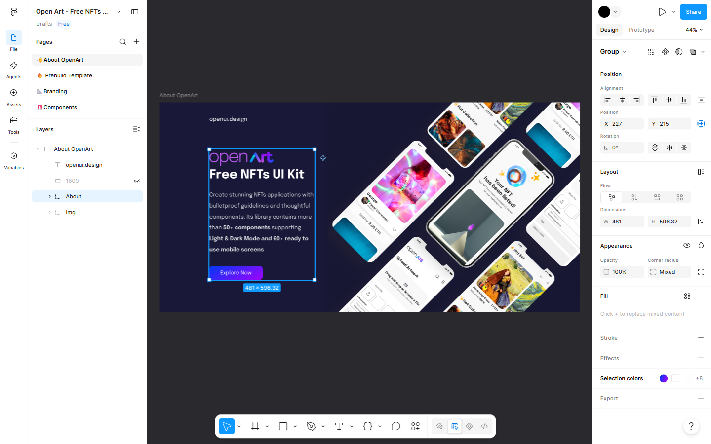
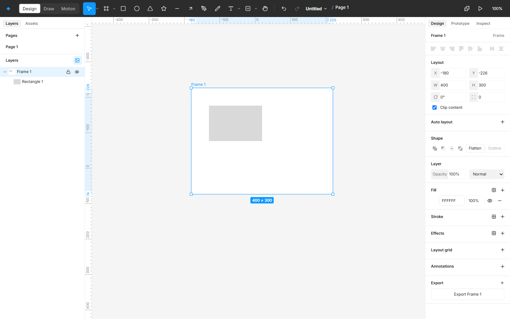
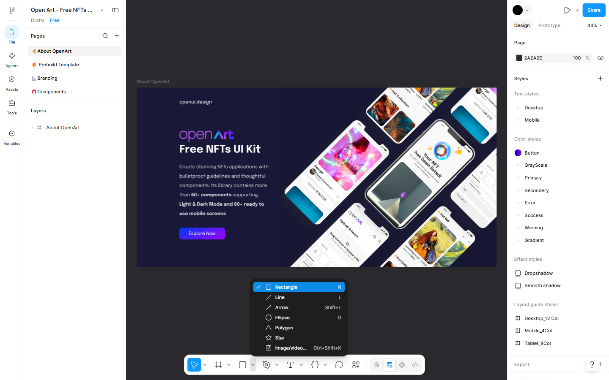
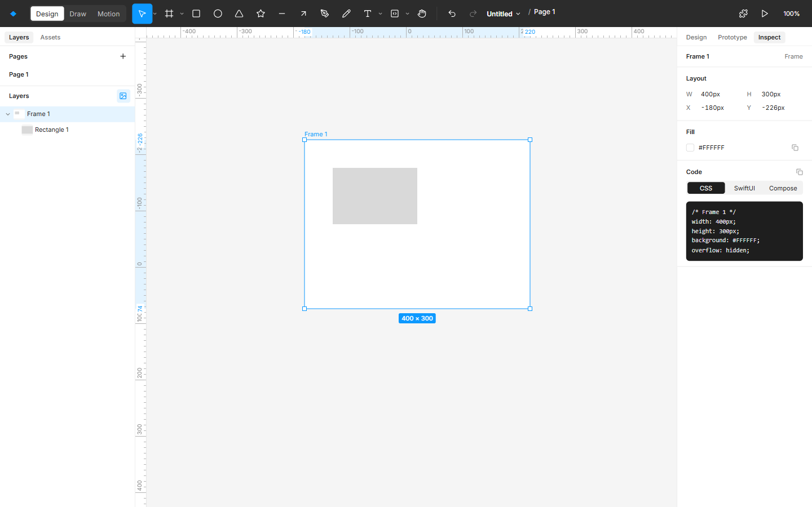
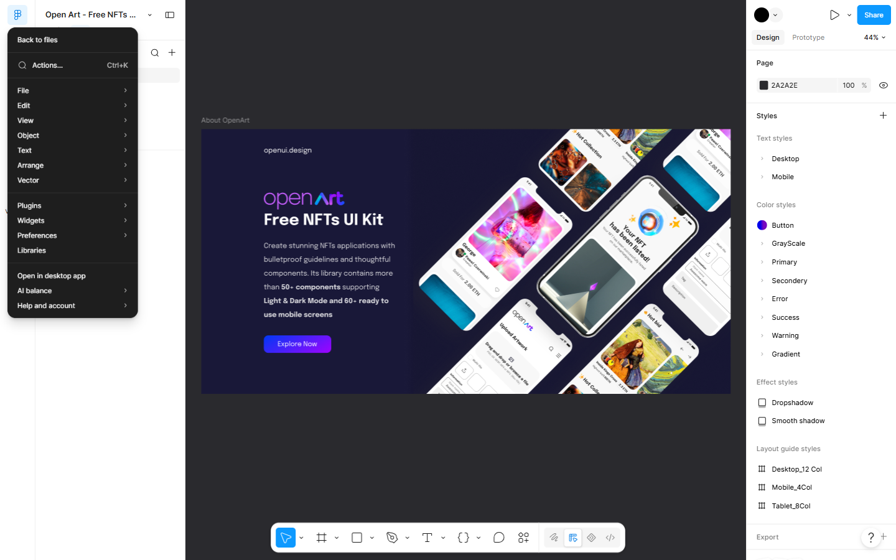
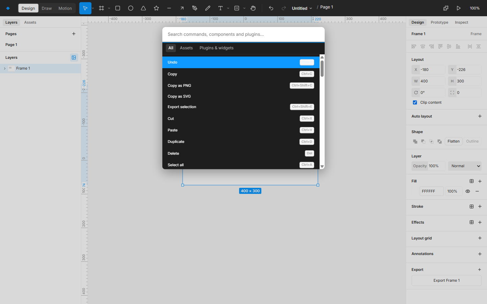

# Figma vs Design Clone: editor UI comparison

Captured on 2026-11-22 with the Playwright MCP server (Chrome, 1440×900).

- **Figma:** the live editor (UI3, Free plan) on an existing design file, opened read-only. Nothing was drawn or changed. Dev Mode needs a paid plan: it showed an upgrade screen with the Inspect panel only partly visible, so the Dev Mode rows also use Figma's help center ([Guide to Dev Mode](https://help.figma.com/hc/en-us/articles/15023124644247-Guide-to-Dev-Mode), [Add measurements and annotations](https://help.figma.com/hc/en-us/articles/20774752502935-Add-measurements-and-annotations-in-Dev-Mode)). Rows marked *(docs)* come from those pages.
- **Ours:** `pnpm --filter @figma/web dev` at `http://localhost:5280/local` (a local file), commit `e23f6a6` (latest `main`). Cloud-only UI (Comment tool, Share, version history) doesn't show at `/local`; it was checked in the source and is marked *(cloud files)*.

Status key: **Same** · **Different name or place** · **Missing in ours** · **Extra in ours**

| Figma | Ours |
| --- | --- |
|  |  |
|  |  |

## 1. Overall layout

| Feature | Figma (name, location) | Ours (name, location) | Status |
| --- | --- | --- | --- |
| Tool bar | Floating toolbar at the **bottom centre** of the canvas | Top bar across the window (dark), with modes, tools, undo/redo, file name, Plugins, Present, zoom | Different name or place |
| Navigation rail | Narrow left rail: **File**, **Agents**, **Assets**, **Tools**, **Variables** | None; Layers and Assets are tabs at the top of the left panel | Different name or place |
| Main menu | Figma logo button, top left of the left panel | Missing (the ◆ logo isn't a button) | Missing in ours |
| File name and location | Top of the left panel: file name + chevron (Edit file menu), with "Drafts · Free" under it | Top bar centre: `Untitled ▾ / Page 1` | Different name or place |
| Minimize UI | Button next to the file name; also View menu, Ctrl+Shift+\ | Quick actions only (Minimize UI, Ctrl+Shift+\) | Different name or place |
| Present / Share | Top of the right panel: avatars (Multiplayer tools), **Present** ▷ with **Prototype view** dropdown, **Share** | Top bar right: Plugins, Present ▷, zoom; Share *(cloud files)* | Different name or place |
| Zoom/view options | `44% ▾` on the right panel's tab row | `100%` in the top bar | Different name or place |
| Undo / Redo buttons | None on screen (menu and shortcuts only) | Buttons in the top bar | Extra in ours |
| Help | `?` button, bottom right | Missing (the editor tour is in quick actions) | Missing in ours |
| Editor tour | — | "Welcome to the editor" tour on first open | Extra in ours |

## 2. Toolbar and tools (Design mode)

Figma groups the tools into seven slots with dropdowns. Ours shows most of them as separate buttons.

| Figma slot → tools (shortcut) | Ours | Status |
| --- | --- | --- |
| **Move tools**: Move (V), **Hand tool** (H), Scale (K) | Move menu: Move (V), Scale (K). Hand is a separate button at the end of the toolbar, named "Hand" | Different name or place (Hand) |
| **Region tools**: Frame (F), Section (Shift+S), Slice (S) | Frame menu: Frame (F), Section (Shift+S), Slice (S) | Same (our menu has no "Region tools" name) |
| **Shape tools**: Rectangle (R), Line (L), Arrow (Shift+L), Ellipse (O), Polygon, Star, **Image/video…** (Ctrl+Shift+K) | Six separate buttons: Rectangle, Ellipse, Polygon, Star, Line, Arrow (in that order). Place image… is in quick actions | Different name or place |
| Image/video… | "Place image…" (quick actions, Ctrl+Shift+K); no video | Different name or place |
| **Creation tools**: Pen (P), Pencil (Shift+P) | Separate Pen and Pencil buttons | Different name or place |
| **Type tools**: Text (T), **Text on path** | Text menu: Text (T), **Text on a path** | Different name (one word) |
| **Code tools**: Code (B), Spec (D) | Code menu: Code (B), Spec (D), **Code snippet**, **Annotate** | Extra in ours (Code snippet, Annotate in this menu) |
| **Comment** (C) | Comment (C) *(cloud files only)* | Same |
| **Actions** (grid icon, Ctrl+K): AI prompts plus the command list | Quick actions (Ctrl+/ and Ctrl+K), no button | Different name or place |
| Annotation (Shift+T), Measurement (Shift+M) *(docs; not shown on the Free plan's Design toolbar)* | "Annotate" under the Code menu, no shortcut; no Measurement tool (Alt-hover shows distances) | Different name or place / Missing in ours (Measurement) |
| Frame presets (right panel while the Frame tool is on) | Frame presets in the right panel (Phone, …) | Same |
| Measurement is Shift+M in Figma *(docs)* | Shift+M is our Shape builder (vector edit bar, quick actions) | Different shortcut (clash if Measurement is added) |

## 3. Modes

| Feature | Figma | Ours | Status |
| --- | --- | --- | --- |
| Mode switcher | Segmented icons at the **right end of the bottom toolbar**, in this order: **Draw**, **Design**, **Motion (Beta)**, **Dev Mode** | Text tabs at the left of the top bar: **Design**, **Draw**, **Motion** | Different name or place (order, position, Dev Mode) |
| Mode name on the right panel | The tab row shows the mode: "Draw", "Motion Beta" | Design / Prototype / Inspect tabs stay the same in every mode | Different name or place |
| Draw toolbar | Move, **Pen / Brush / Pencil** (drawn as real pens), Frame, Shape, Text, Code, Comment, Actions | Move, Pen, Brush, Pencil, Text, Hand (Comment on cloud files) | Different name or place (ours drops Frame, Shape, Code) |
| Dev Mode | Mode in the toolbar (Shift+D), paid plans; its own right panel (Inspect, Plugins) | **Inspect tab** in the right panel, in every mode | Different name or place |

## 4. Left panel

| Feature | Figma | Ours | Status |
| --- | --- | --- | --- |
| Pages | "Pages" header, **search** and **+ (Add new page)** | "Pages" header with + (Add page) | Missing in ours (page search) |
| Layers | "Layers" header with a layout/collapse toggle; thumbnails for frames | "Layers" header with "Show layer icons" toggle; "Layer thumbnails" in quick actions | Same |
| Find | Find (magnifier) next to Pages; Edit > Find (Ctrl+F) | Find and replace… (Ctrl+F) in quick actions | Different name or place |
| Assets | Left rail **Assets**: All libraries, Created in this file, UI kits (iOS and iPadOS, Material 3, Simple Design System), Add more libraries | **Assets** tab: Local components, Libraries | Different name or place (rail vs tab; no UI kits) |
| Variables | Left rail **Variables** (collections) | "Variables" section in the right panel when nothing is selected → **Open variables**; Local variables (Ctrl+Alt+V) | Different name or place |
| Tools | Left rail **Tools**: plugins, widgets, shaders, AI image tools | **Plugins** button in the top bar (built-in plugins, Write a plugin, Add from a URL/file) | Different name or place |
| Agents | Left rail **Agents** (AI chat on the file) | — | Missing in ours |

## 5. Right panel: Design tab

Nothing selected:

| Figma | Ours | Status |
| --- | --- | --- |
| **Page** (background colour, opacity, eye) | "Page 1 · Page", **Background** (colour, opacity, Hide, Remove, Show in exports) | Different name ("Page" vs "Background") |
| **Styles** with + : Text styles, Color styles, Effect styles, **Layout guide styles** | **Local styles** (hint text until a style exists) | Different name or place |
| Export | Export (Layers on this page / all pages, Export files) | Same |
| — | **File → Export file as JSON** | Extra in ours |

Layer selected (frame / group):

| Figma section → contents | Ours | Status |
| --- | --- | --- |
| Header: layer type with dropdown ("Frame ▾", "Group ▾"), quick buttons (component, mask, …) | Name + type text ("Frame 1 · Frame") | Different name or place |
| **Position**: Alignment, Position X/Y, Rotation (with flip buttons), constraints | Alignment buttons at the top, X/Y and rotation in **Layout**; **Constraints** section on children | Different name or place |
| **Layout**: auto layout toggle; Flow: **Freeform / Vertical / Horizontal / Grid**; Dimensions W/H, lock aspect ratio, Clip content | **Layout** (X, Y, W, H, rotation, corner radius, Clip content) + separate **Auto layout** section with + | Different name or place |
| **Appearance**: Opacity, Corner radius, Hide (eye), Blend mode | **Layer**: Opacity, blend mode list | Different name |
| Fill, Stroke, Effects | Fill, Stroke, Effects | Same |
| **Selection colors** | — | Missing in ours |
| **Layout guide** | **Layout grid** | Different name |
| Export | Export | Same |
| — | **Shape** (Flatten, Outline) | Extra in ours |
| — | **Annotations** section in the Design tab | Extra in ours (Figma puts annotations on the canvas / Dev Mode) |
| Text layer: **Typography** | Typography | Same |
| Instance / component properties | Instance / Properties / Variants | Same |

## 6. Prototype tab

| Figma | Ours | Status |
| --- | --- | --- |
| **Prototype with Agent** (AI) | — | Missing in ours |
| Flow starting point (on frames) | Flow starting point ("Start a prototype here") | Same |
| Interactions (+) | Interactions | Same |
| Scroll behavior → **Position** (Scroll with parent…) and Overflow | Scroll behavior → Overflow (No scrolling, Vertical, Horizontal, Both directions); "Position when scrolling" | Same |
| **Show prototype settings** (device, background, starting frame) | — | Missing in ours |
| Present ▷ + **Prototype view** dropdown | Present ▷ | Missing in ours (Prototype view dropdown) |

## 7. Inspect / Dev Mode

| Figma (Dev Mode, paid) | Ours (Inspect tab) | Status |
| --- | --- | --- |
| Separate mode with Inspect and Plugins tabs | Inspect tab next to Design / Prototype | Different name or place |
| Layer name, type, last updated; **Compare changes** *(docs)* | Name + type; no change comparison | Missing in ours (Compare changes) |
| **Ready for dev** / Mark as ready for dev, "Ready for development" in the layers panel | — | Missing in ours |
| Dev resources, Component info, Code Connect *(docs)* | — | Missing in ours |
| **Layer properties** with **Code / List** toggle | Layout (W, H, X, Y), Fill, Typography as lists | Different name or place |
| Code: language dropdown (CSS, iOS, Android, plugins) | **Code**: CSS, SwiftUI, Compose | Same |
| Colors, Assets (icon detection, downloads), Export | Fill colours; Export is in the Design tab | Different name or place |
| Annotation (Shift+T) and Measurement (Shift+M) tools *(docs)* | Annotate (Code menu), Spec tool; Show annotations (Shift+Y) | Different name or place |

## 8. Motion

| Figma | Ours | Status |
| --- | --- | --- |
| "Motion Beta" mode; timeline at the bottom across the left panel too | Motion mode; timeline at the bottom, under the canvas only | Same (layout differs slightly) |
| Timeline header: Play ▷, keyframe ◇, time `00:00:000 ms`, auto-keyframe toggle, zoom − / + on timeline, ruler `0s, 200ms … 1s … 2s` | Play (Space), auto-keyframe toggle, current time `0ms` / duration `2000ms`, `ms`/`s` unit toggle, selected layer name, zoom slider, ruler `0ms … 2500ms` | Different name or place (ours shows the duration and uses a slider for zoom; Figma has a keyframe ◇ button and − / + zoom) |
| Right panel **Animations** (+) at the top | **Animations** (+) under Animate | Same |
| **Transform**: Position, Scale, Rotation, each with a ◇ keyframe button beside the field | **Animate** section: a list of ◇ X, Y, Width, Height, Rotation, Scale X, Scale Y, Opacity, Corner radius, Fill, Stroke, Stroke weight, Blur, shown **above** the normal Design sections | Different name or place |
| Keyframe ◇ on Layout (W/H) and Appearance fields | Keyframes only in the Animate list | Different name or place |
| **Audio** section, Add audio | — | Missing in ours |
| Right-click → **Add motion** (Design mode) | Motion mode in quick actions | Missing in ours (context menu item) |

| Figma Motion | Our Motion |
| --- | --- |
|  |  |

## 9. Menus and quick actions

| Figma | Ours | Status |
| --- | --- | --- |
| **Main menu**: Back to files, Actions…, File, Edit, View, Object, Text, Arrange, Vector, Plugins, Widgets, Preferences, Libraries, Open in desktop app, Help and account | — | Missing in ours |
| **Actions** (Ctrl+K): AI prompts on top (Ask for changes, Create variations, …), then All / Assets / Plugins & widgets tabs and suggested commands | **Quick actions** palette (Ctrl+/ and Ctrl+K): All / Assets / Plugins & widgets tabs, full command list | Different name (Actions vs quick actions; Figma has no Ctrl+/) |
| Edit file menu (chevron by file name): Show version history, Publish library…, Export…, Add to sidebar, Create branch…, File color profile, Duplicate, Rename, Move file…, Move to trash | File-name menu: Rename file, Your account's files, New file, Libraries…, Theme, Files in this browser | Different name or place |
| Edit menu: Copy properties / Paste properties, Pick color (I), Select matching layers, Select inverse, Paste to replace, Paste over selection | — (copy as PNG/SVG exists) | Missing in ours |
| Object menu: Wrap in new section, Flip horizontal/vertical, Rotate 90°/180°, Remove fill/stroke, Swap fill and stroke, Boolean groups | Boolean ops, Flatten, Outline stroke, mask, auto layout (context menu); no flip/rotate commands | Missing in ours (flip, rotate, fill/stroke commands) |
| Arrange menu: Tidy up, Pack, Distribute… | Align ×6 only | Missing in ours (Tidy up, Distribute, Pack) |
| Vector menu: Join, Smooth join, Delete and heal, Split, Simplify, Offset | Vector edit actions (F6) | Same (not compared item by item) |
| Text menu: Bold, Italic, Underline, Strikethrough, Create link, Bulleted / Numbered list | — | Missing in ours (as a menu) |
| Right-click: Copy, **Paste here**, **Paste to replace**, **Copy/Paste as**, Build this with code, **Add motion**, **Select layer**, **Move to page**, order, group, Flatten, Outline stroke, mask, auto layout, Create component, Plugins, Widgets, Show/Hide, Lock/Unlock, **Flip** | Copy, Copy as PNG/SVG, Paste, Duplicate, Delete, order ×4, group, component, variants, instance commands, frame, auto layout, mask, boolean ×4, Flatten, Outline stroke, Show/Hide, Lock/Unlock, Zoom to selection | Different name or place |
| Theme in Preferences > Theme | Theme in the file-name menu and quick actions | Different name or place |
| — | "Renderer: use Canvas 2D", "Create a 10,000-layer test page" (quick actions) | Extra in ours (debug commands) |

## 10. View settings

| Figma (View menu and zoom/view options) | Ours | Status |
| --- | --- | --- |
| Zoom in/out, Zoom to fit, **Zoom to 50% / 100% / 200%**, Zoom to selection | Zoom in/out, Zoom to fit, Zoom to selection, Zoom to 100% | Missing in ours (50%, 200%) |
| Zoom to 100% = **Ctrl+0** | Zoom to 100% = **Shift+0** | Different shortcut |
| Pixel grid, Snap to pixel grid, **Pixel preview** | Snap to pixel grid (quick actions) | Missing in ours (Pixel grid toggle, Pixel preview) |
| **Layout guides** (Shift+G) | "Show/Hide layout grids" (Ctrl+Shift+4) | Different name and shortcut |
| Rulers (Shift+R) | Show rulers (Shift+R) | Same |
| **Outlines**, Mask outlines, Frame outlines | — | Missing in ours |
| Show slices, Comments (Shift+C), Annotations (Shift+Y), Additional labels, Multiplayer cursors | Show annotations (Shift+Y), Multiplayer cursors | Missing in ours (Show slices, Additional labels) |
| Previous/next page, Zoom to previous/next frame (N / Shift+N) | — | Missing in ours |
| Preferences: snapping, Keep tool selected after use, Nudge amount…, etc. | Nudge amount… only | Missing in ours (most preferences) |

## 11. Export

| Figma | Ours | Status |
| --- | --- | --- |
| Export section (+) in the Design tab, Export… (Ctrl+Shift+E) | Export section, Export selection (Ctrl+Shift+E) | Same |
| File > **Export frames to PDF…** | — | Missing in ours |
| File > Save local copy… (.fig) | Export file as JSON (right panel) | Different name or place |
| Save to version history…, Show version history | Version history *(cloud files)* | Same |
| Motion export (video) | Video / Lottie / dotLottie / animated SVG export | Same |

## Prioritized fixes (smallest and most visible first)

1. **"Text on a path" → "Text on path"** in the Text menu. One string.
2. **Rename "Hand" to "Hand tool" and move it into the Move menu** (Move, Hand tool, Scale), dropping the separate Hand button.
3. **Rename right-panel sections**: "Layer" → **Appearance**, "Layout grid" → **Layout guide** (and "Show/Hide layout grids" → **Layout guides**, Shift+G), "Background" → **Page**, "Local styles" → **Styles**.
4. **Zoom to 100% shortcut**: Ctrl+0 (Figma) instead of Shift+0; add Zoom to 50% / 200% to the zoom menu.
5. **Group the shape buttons into one "Shape tools" slot** (Rectangle, Line, Arrow, Ellipse, Polygon, Star, Image/video…) and **Pen + Pencil into "Creation tools"**. Our toolbar then has Figma's seven slots.
6. **Code menu**: move "Code snippet" and "Annotate" out (Figma has Code and Spec only). Rename "Annotate" to **Annotation** with Shift+T.
7. **Mode switcher order and names**: Draw, Design, Motion, Dev Mode; consider renaming the Inspect tab to Dev Mode, or keep Inspect and note the difference.
8. **Rename "quick actions" to Actions** and add an Actions button to the toolbar.
9. **Add Selection colors** to the Design tab (Figma shows it for any multi-colour selection).
10. **Restructure Position / Layout**: split X/Y/rotation and alignment into a **Position** section; put auto layout's Flow (Freeform / Vertical / Horizontal / Grid) and Dimensions into **Layout**.
11. **Move the toolbar to the bottom centre** with the mode switcher at its right end, and put Present / Share / zoom at the top of the right panel. This is the biggest visual difference.
12. **Add a main menu** (logo button) with File / Edit / View / Object / Text / Arrange / Vector / Preferences. That gives a home to missing commands: Tidy up, Distribute, Flip, Rotate, Copy/Paste properties, Select matching layers, Outlines, Pixel preview.
13. **Motion**: name the property section **Transform** (Position, Scale, Rotation) with ◇ buttons beside the normal fields, and add **Add motion** to the right-click menu.
14. **Left navigation rail** (File, Assets, Variables): larger change; it moves Assets out of the left-panel tabs and Variables out of the right panel.
15. Dev Mode extras: Ready for dev, Compare changes, Measurement tool (Shift+M).

Not worth copying: Figma's AI entries (Agents, Prototype with Agent, Actions AI prompts, Build this with code), Widgets, Publish library / branches (plan features).
